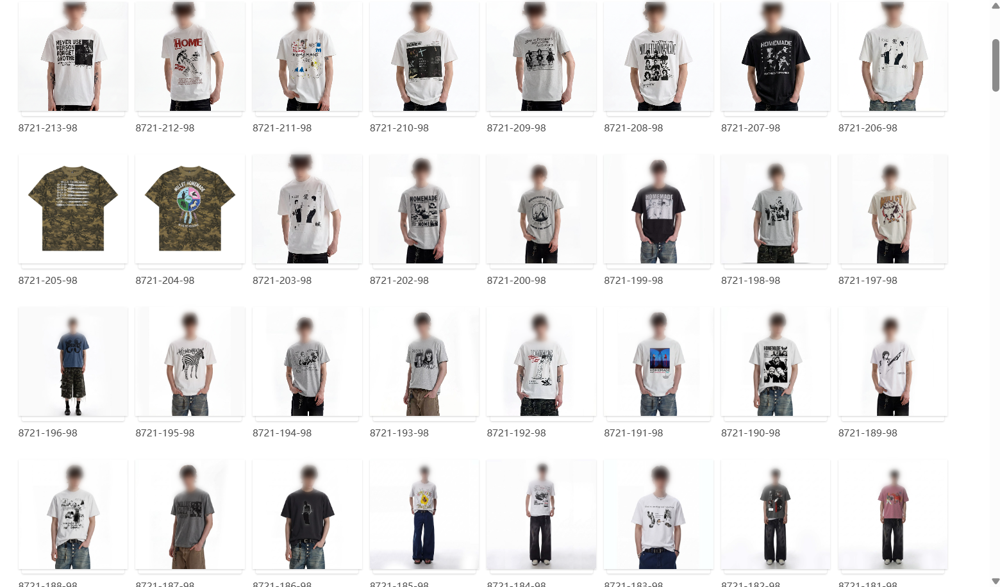
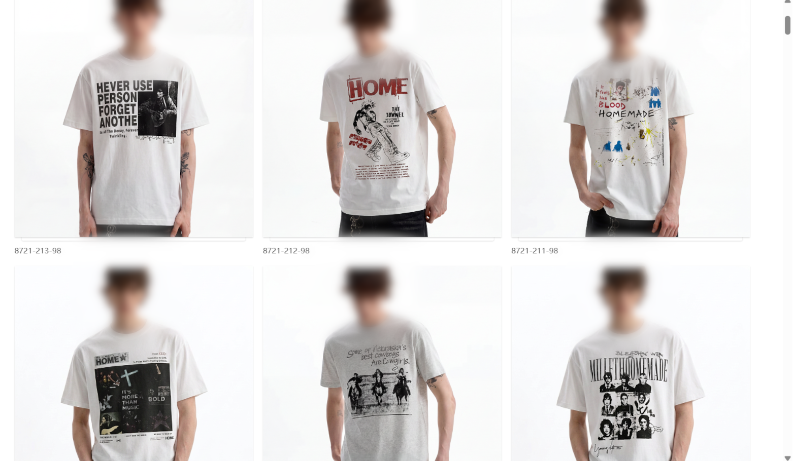
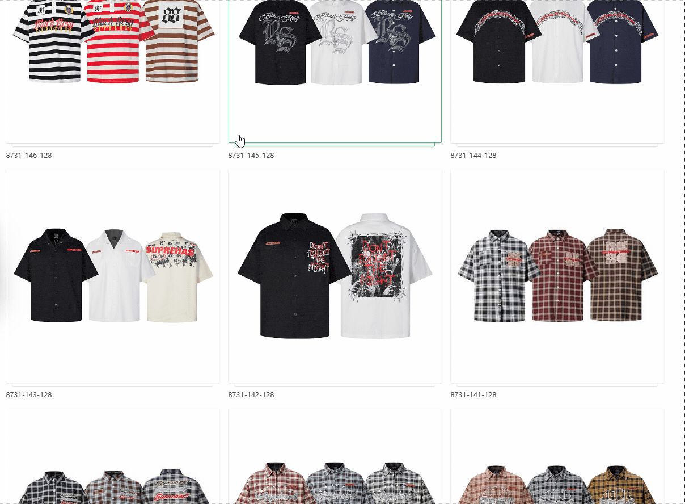

# Yupoo Gallery+

A small userscript that makes browsing [Yupoo](https://yupoo.com) galleries less painful:

- **Larger album tiles**: responsive grid with higher-resolution thumbnails.
- **Hover preview**: move the cursor over an album to see its cover in full size, with the album title, without opening it. `Esc` closes it.
- **Price badges**: reads the CNY price from the album title (`￥138`, `138RMB`, `RMB 138`, `138元`) and shows it converted to your currency.
- **Album dates and age filter**: shows when an album was published and lets you hide albums older than N years.

## Demo

|                     Before                     |                 After                  |
| :--------------------------------------------: | :------------------------------------: |
|  |  |

## Install

### As a userscript (recommended)

1. Install a userscript manager, e.g. [Tampermonkey](https://www.tampermonkey.net/) or [Violentmonkey](https://violentmonkey.github.io/).
2. Open the raw script file: [`yupoo-gallery-plus.user.js`](https://raw.githubusercontent.com/mjazlowiecki/yupoo-gallery-plus/main/yupoo-gallery-plus.user.js)
   (the manager should offer to install it), or create a new script and paste the file contents.
3. Open any Yupoo gallery page and refresh.

### As a browser extension (unpacked)

1. Download or clone this repository.
2. Open `chrome://extensions`, enable **Developer mode**.
3. Click **Load unpacked** and select the repository folder.

## Usage

On a gallery page you get:

- a price badge (top left) and a date badge (top right) on every album tile,
- an **Age** selector in the bottom-right corner that hides albums older than 1, 2, 3 or 5 years,
- the Tampermonkey menu (userscript build only) with these commands:
  - **Tiles: bigger / smaller**: change the tile size,
  - **Toggle hover preview**,
  - **Set CNY rate…**: set how much 1 CNY is worth in your currency,
  - **Toggle price badges**,
  - **Toggle album dates**: turns off date badges, the age filter and the date requests,
  - **Reset settings**.

Choices are saved between visits. The unpacked-extension build has no menu, so there edit
`DEFAULTS` at the top of the script instead (the **Age** selector works in both builds).

## Configuration

Edit the `DEFAULTS` object at the top of `yupoo-gallery-plus.user.js`:

| Option            | Default     | Description                                                                        |
| ----------------- | ----------- | ---------------------------------------------------------------------------------- |
| `tileMinWidth`    | `300`       | Minimum tile width in px. Higher = fewer, bigger tiles                             |
| `gap`             | `16`        | Gap between tiles in px                                                            |
| `previewMaxW`     | `560`       | Max width of the hover preview in px                                               |
| `previewMaxH`     | `760`       | Max height of the hover preview in px                                              |
| `hoverDelay`      | `120`       | Delay before the preview appears, in ms                                            |
| `tileAspect`      | `'1 / 1'`   | CSS aspect ratio of tile images (e.g. `'3 / 4'` for portrait covers)               |
| `previewEnabled`  | `true`      | Whether the hover preview is shown                                                 |
| `showPrices`      | `true`      | Show converted price badges                                                        |
| `currency`        | `'PLN'`     | Target currency (ISO code)                                                         |
| `cnyRate`         | `0.55`      | Value of 1 CNY in the target currency. **Update it to the current rate**           |
| `bareNumberIsCny` | `false`     | Treat a leading bare number in the title (`138 be123`) as a CNY price              |
| `showDates`       | `true`      | Show date badges, the age selector, and fetch sample dates                         |
| `dateSamples`     | `6`         | Albums fetched per page to calibrate date estimates (minimum 2)                    |
| `maxAgeYears`     | `0`         | Hide albums older than this many years (`0` = no filter)                           |
| `sort`            | `'default'` | Order of albums on the page: `default`, `newest`, `oldest`, `cheapest`, `priciest` |

## How it works

- The album grid is found by locating links to `/albums/` and walking up the DOM, so the script
  does not rely on Yupoo's CSS class names.
- Yupoo serves each photo in several sizes (`square`, `small`, `medium`, `big`). The script swaps the
  size in the image URL: `medium` for tiles, `big` for the preview, with a fallback to the original
  thumbnail if a size is missing.
- Hover handling uses event delegation, and a `MutationObserver` re-applies the layout when
  tiles are added dynamically.
- **Prices** are parsed from the album title with a few patterns (`￥`/`¥`, `RMB`/`CNY`, `元`) and
  multiplied by the configured rate. The exchange rate is not fetched automatically.
- **Dates**: the album list has no dates, but every album page contains its publish date in
  structured data (JSON-LD `datePublished`). Album pages are large, so the script fetches only a few
  per gallery page (`dateSamples`, evenly spaced by album id, one request every 400 ms) and
  interpolates the rest, because album ids grow with time. Fetched dates are cached locally.

## Limitations

- The preview shows the album **cover** only, not the other photos in the album.
- Prices are only recognised when the title uses a currency marker (`￥`, `RMB`, `CNY`, `元`);
  titles with a bare number are ignored unless `bareNumberIsCny` is enabled. Prices drawn inside
  the photo itself are not read.
- Dates shown with a `~` (for example `~2025-03`) are **estimates** with month precision, based on
  the assumption that album ids increase with publish date. Dates without `~` were read from the
  album page. Albums outside the range of known dates get no badge and are never hidden by the filter.
- Built against the current Yupoo markup. If the site changes its HTML, selectors may need updating.
- In the extension build, settings and cached dates are stored per Yupoo subdomain.
- Tested on Chromium-based browsers with Tampermonkey.
- Sorting applies only to the albums loaded on the current page (up to 120 on Yupoo), not the whole category. Albums without a recognised price go last when sorting by price.

## Contributing

Issues and pull requests are welcome. If something looks broken on a particular gallery page,
please include the page URL and (if possible) the HTML of one album tile.
See [CHANGELOG.md](./CHANGELOG.md) for the version history.

## Disclaimer

This project is not affiliated with or endorsed by Yupoo. It only changes how pages are displayed
in your own browser. To estimate dates it requests a few album pages from Yupoo itself; it does not
send any data to other servers, and settings and cached dates stay in your browser.

## License

[MIT](./LICENSE)
